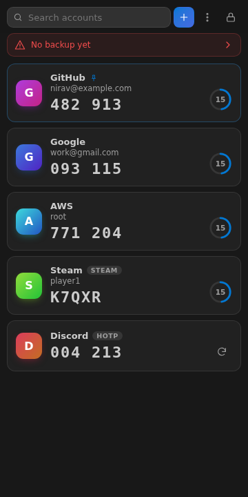
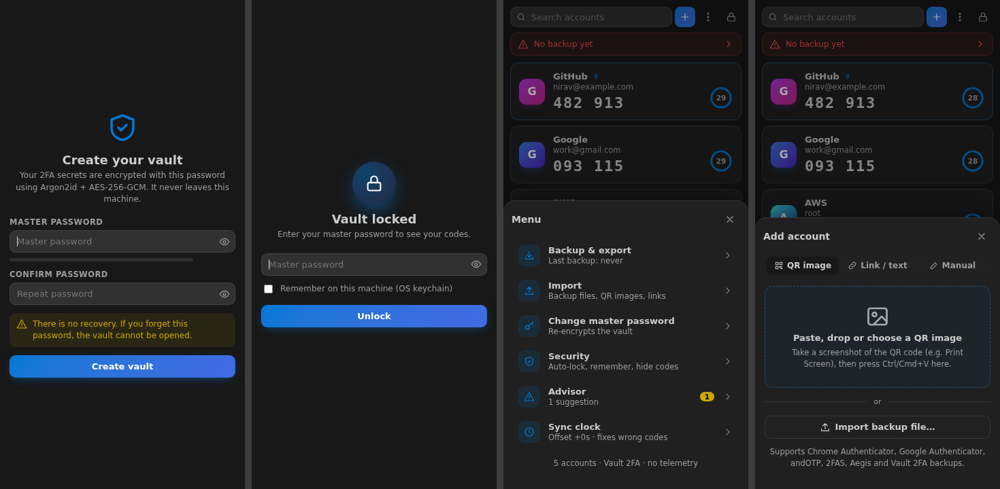

# Authora — 2FA Authenticator for VS Code

A password-protected two-factor authenticator (TOTP/HOTP) in your VS Code sidebar.
Your codes are one click away, and your secrets are encrypted and never leave your machine.
No account, no cloud, no telemetry.





## Quick start
1. Click the 🛡 **Authora** icon in the Activity Bar.
2. Create a master password. There is no recovery, so keep a backup.
3. Click **+** and paste a QR screenshot (Ctrl/Cmd+V), drop a QR image, paste an `otpauth://` link,
   or import a backup from another app.
4. Click a card to copy its code, or press **Ctrl+Alt+2** (Cmd+Alt+2 on macOS) from anywhere.

## Features
- **Codes:** TOTP, HOTP, Steam Guard, Battle.net and hex secrets; SHA-1/256/512; 1–10 digits; custom periods.
- **Encrypted vault:** your master password goes through Argon2id (64 MiB, 3 passes) to make an
  AES-256-GCM key. Nothing is ever stored in plain text.
- **Locking:** the vault locks when VS Code starts, when you click lock, and after inactivity.
  Wrong passwords are throttled.
- **Remember on this machine (optional):** keeps the key in the OS keychain through VS Code SecretStorage.
- **Adding accounts:** paste or drop a QR screenshot, paste `otpauth://` links (including Google
  Authenticator export links), or type the details by hand.
- **Import:** Chrome Authenticator backups (plain and password-encrypted), Google Authenticator,
  andOTP, 2FAS, Aegis (unencrypted) and Authora backups.
- **Backup:** encrypted export file, plus auto-backup to a folder after every change. Point it at a
  Dropbox/Drive/OneDrive folder for cloud sync.
- **Account management:** click a card to copy its code (the clipboard clears automatically), pin,
  drag to reorder, search, edit, show QR, delete.
- **Commands:** `Ctrl+Alt+2` copies a code from anywhere, "Insert Code into Editor" types one in,
  and the status bar shows the lock state.
- **Advisor:** warns when you have no backup or a stale one, or auto-lock is off.
- **Clock sync:** corrects for a wrong system clock.

## Moving from another authenticator
| From | How |
|---|---|
| Chrome "Authenticator" extension | Its menu → Backup → download file → **Import backup file…** (encrypted backups work too) |
| Google Authenticator | Transfer accounts → screenshot the QR → paste it into the Add sheet |
| andOTP / 2FAS / Aegis | Export an **unencrypted** JSON backup → **Import backup file…** |

## Settings
| Setting | Default | |
|---|---|---|
| `authora.autoLockMinutes` | 15 | 0 = never |
| `authora.clipboardClearSeconds` | 30 | 0 = never |
| `authora.rememberOnThisMachine` | false | key in OS keychain, opens without a password |
| `authora.autoBackupFolder` | "" | encrypted backup after every change |
| `authora.backupKeep` | 10 | |
| `authora.hideCodes` | false | blur until hover |

## Security notes
- Network: the only request is the optional **Sync clock** (HEAD to google.com, to read the time).
- The webview UI never receives your secrets. Codes are generated in the extension host.
- If you enable "Remember on this machine", anyone with access to your OS account can open the vault.

## Disclaimer
Provided as is, without warranty (MIT). Before removing your secrets from another authenticator,
**keep an independent backup**. If you lose the vault and its backups you can be locked out of
your accounts.

## Releasing (maintainers)
Releases are published by GitHub Actions through Marketplace **trusted publishing**, so no token is stored anywhere.
1. Add a `## x.y.z` section to `CHANGELOG.md`.
2. Run `npm version patch` (or `minor`/`major`). This bumps `package.json`, commits and tags `vx.y.z`.
3. Run `git push --follow-tags`. The **Release** workflow tests, publishes to the Marketplace and creates the GitHub release with the `.vsix`.

One-time setup: Marketplace → publisher **NiravPatel15** → **Trusted Publishing** → **Create**, with owner
`NIRAV-PATEL-15`, repository `authora`, workflow `release.yml`, and environment left empty.

## Develop
```bash
npm install
npm test          # core unit tests
npm run build     # bundles dist/extension.js + dist/webview.js
npm run package   # builds authora-<version>.vsix
code --install-extension authora-0.1.0.vsix
```
Press F5 in this folder to launch an Extension Development Host.

## Where data lives
`~/.config/Code/User/globalStorage/NiravPatel15.authora/vault.json` (Linux) holds the encrypted envelope
`{v, kdf:{argon2id, salt, m, t, p}, iv, ct}`. Without the password it is useless.
There is **no password recovery**, so keep a backup.
